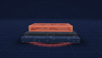
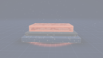
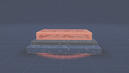
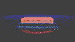

#+title: A checked pixel survives a live edit
#+subtitle: What happened when the same frame went through Enchant, Bend and two physical GPUs.
#+kicker: Checked tiles / laboratory journal
#+date: 2026-11-18
#+status: Hardware execution, proof checking, stale completion and negative controls exercised

* Start with the edit

#+begin_lede
On the first save, a BL function washed a film frame toward white. On the next, its helper mixed less white into every channel. A worker still holding the first revision finished its frame. The second revision stayed visible. A third save introduced a one-character boundary error in a posterization function. The actual compiled function returned 63 for input 64, and Lean checked that this violated the protected law.
#+end_lede

From the checkout root, run =research/checked-tiles/run --require-gpu --sweep=. Open the printed session's =original.png= and =current/frame.png=. To save edits yourself, follow the watch example in the [[file:../README.md][runner guide]]. The source, compiled CPU and GPU code, generated theorem and output remain together in each revision directory.  ·  ·  · 

* What the project actually built

We specialized the integer white-over-destination blend used in Enchant’s pixel work to three packed RGB channels. The input is a retained frame from the Ora renderer. The author writes an ordinary unary BL definition and may call preceding helpers. The original BL compiler renders the frame and evaluates the function for every byte. A small research reader recognizes the pure arithmetic subset and emits a shared C/OpenCL expression and a Lean expression. A conservative bound on every intermediate licenses 32-bit arithmetic. A C/OpenMP worker and a two-dimensional OpenCL kernel each write a fresh, disjoint output. Every clipped edge and every byte value has concrete differential coverage. [[file:../examples/wash.bl][Wash]] · [[file:../region.py][Admitted syntax and numeric rules]] · [[file:../evidence/Revision.lean][Exact theorem checked for the first image]]

#+begin_sequence :title "Ownership during a live edit"
lanes author · application author | compiler · BL compiler | checker · Lean | owner · publisher | worker · native request
author -> compiler : capture one source snapshot
compiler -> checker : BL observations and candidate expression
checker -> owner : checked channel law and geometry
owner -> worker : old revision computes its first strip
author -> owner : edited helper clears qualification and becomes current
worker -> owner : old revision finishes its second strip
note owner, worker : The owner rejects the old publication and the old ELF disappears from the process map after join.
#+end_sequence

The watch command was also exercised with real file saves on a 9×5 frame. A rejected save preserved the published directory, and a subsequent valid save made its exact source bytes current. [[file:../evidence/watch.json][Watch exercise]]

The first prototype observation was unexpected. For a pure unary byte operation, all 256 possible results fit in a 256-byte lookup table. The values that independently check the mathematical expression can themselves execute a backend. This gave us an extra implementation and a useful baseline for almost no machinery. It also exposes the limits of the experiment. A 3×3 spatial filter depends on nine pixels. Two inputs can share the same central channel and require different outputs. Such a filter needs a different input domain, boundary law and ownership argument.

* What qualified

| Question | Evidence and scope |
|----------+--------------------|
| Does the expression brighten or preserve every admitted channel and still fit a byte? | Lean decides the universal finite proposition. It separately checks that all 256 BEAM results equal evaluation of the expression. Both first-wash theorems have empty axiom lists. |
| Which lane owns an address? | Lean checks quotient/remainder reconstruction, uniqueness, launch coverage and the clipped store model. Geometric proofs have their own recorded standard Lean axiom dependencies. |
| Did the actual backends implement that model? | Compiled BEAM frame, generated C and OpenCL, edge cases, and the byte table agree. Emission and driver execution remain reviewed and tested boundaries. |
| Is the bad edit visibly rejected? | The compiled observation at 64 and a Lean-checked counterexample agree. The accepted symlink still points to the posterized image. |
| What happens if the lowerer is wrong even though the law is true? | A deliberately wrong OpenCL edge computes 62 for channel 0 where 63 is required. The actual GPU differential catches it. A shifted coordinate in the Lean model separately breaks the stitch proof. |

These checks concern the declared mathematical model and the retained executable observations. The code runs from this research driver and its pinned SDK. Integrating the decision with Enchant’s production ANF pass, Source owner and deployment admission remains open. The two native templates use reviewed address arithmetic. The Lean file models that arithmetic, while its extraction from target binaries would require another bridge. [[file:../evidence/lean.txt][Axiom audit]] · [[file:../evidence/controls.json][Mutation outcomes]] · [[file:../evidence/exercise.json][Publication receipt]]

* Where the milliseconds went

The first 129×73 image contains 28,251 channel values. The original BL wash took 23.05 ms inside its capture process. For the same image, four-thread compiled CPU execution took 0.012 ms median, the finite lookup took 0.016 ms, and a complete GTX 1660 Ti OpenCL call took 0.184 ms. The GPU call includes host buffers, transfer, launch, synchronization and readback. Five samples per route, on a shared and at times heavily swapping workstation, limit the precision of a ranking. The raw samples include the first call. [[file:../evidence/first.json][Exact inputs, tools, timings and hashes]]

| First wash, median milliseconds | Four CPU threads | Byte table | GTX 1660 Ti whole call |
|---------------------------------+------------------+------------+------------------------|
| 8×8 RGB | 0.0039 | 0.0004 | 0.153 |
| 320×180 RGB | 0.049 | 0.096 | 0.327 |
| 1920×1080 RGB | 2.046 | 3.565 | 7.073 |

The size sweep repeats captured frame bytes and checks every result against the table. Greater size alone did not rescue GPU placement for this operation. And the small lookup beat four threads on the patch. Both observations depend on the cost of getting the result back to a CPU caller. The renderer's actual EGL executor, running an independent integer wash shader with the texture already resident, measured 0.140 ms median for draw and finish on Intel UHD Graphics 630. Its readback agreed exactly. This machine's graphics and compute paths even selected different physical devices. [[file:../evidence/scene-comparison.json][EGL renderer identity and samples]]

Cold work changes the conclusion again. The first qualified run spent 28.7 seconds in the BL capture process and 11.7 seconds starting Lean and checking the generated file. A later revision on the same machine cleared all gates in about 12 seconds. The initial cold experiment saw even greater host pressure. A submillisecond kernel cannot make those pauses feel interactive. Reusing an immutable preparation and a warm proof environment is a product requirement worth measuring on the very next edit. The existing compiler and Source generation work has direct relevance here.

* What running Bend taught us

The Bend counterpart reads the same file, applies the same integer operation and writes exactly the accepted BEAM bytes. We pinned Bend 2.0.40 at =9c586f09=, Bun, Clang, the NVIDIA libraries and the compiler sources used. Both CPU and CUDA executed on this workstation. We requested CUDA explicitly, built its device program and required success on device execution.

Getting the comparison to work changed the interpretation of the design paper. The initial representation passed the whole frame into a tree of linked-list chunks. On this host it encountered a native memory fault. Raising the native stack allowed a one-thread CPU run to complete. The device run still failed on a 2,048-byte input while a 256-byte probe completed. This localizes a symptom. It does not establish the cause or a general Bend size limit. We changed to one process reading bounded 256-byte chunks with 32 leaves per chunk. The same stream shape then completed on every requested Bend executor. That puts roughly 111 dispatch opportunities into one small image, which matters much more here than the arithmetic. [[file:../comparison/wash.bend][Reproducible counterpart]] · [[https://github.com/bendlang/bend/blob/9c586f094f4fc88bef440dc8b4d77a2f92c257cc/bend2/docs/BendRT/main.typ][BendRT execution model]]

The fresh-process comparison starts each program with the same packed input and requires it to write the identical output. The prepared Enchant CPU wrapper loads its ELF, and the OpenCL wrapper opens the driver and builds its program. Bend starts its prebuilt binary and prebuilt device artifact. FFmpeg runs its production lutrgb filter. Five rounds rotate launch order. These times can be compared as user-visible operations under these deployment choices. They cannot isolate compiler code quality.

| Fresh process, input file to output file | Median milliseconds |
|------------------------------------------+---------------------|
| Bend, one CPU thread | 13.13 |
| Bend, four CPU threads | 15.82 |
| FFmpeg | 26.40 |
| Enchant prepared CPU via Python driver | 90.72 |
| Enchant OpenCL via Python driver | 250.39 |
| Bend CUDA, required | 261.34 |

Bend won the cold CPU comparison even though the Enchant CPU arithmetic ran in microseconds. Enchant’s Python process, module imports, library load and IO are part of the implemented product path. We have a reason to retire them from a latency-sensitive deployment. Conversely, a resident Enchant service already paid several of those costs. The workload that decides an architecture is the one its users actually invoke. [[file:../evidence/bend-comparison.json][Raw same-boundary samples]]

* What an output checksum missed

With the first retirement implementation, a fresh CPU worker wrote every expected byte and then segfaulted on exit. Unloading its last region also unloaded the OpenMP runtime while its workers could still be alive. The fix gives the shared scheduler process lifetime and each region its own lifetime. Twelve isolated CPU replay processes then exited cleanly. The qualification now checks the actual disappearance of the old region ELF from =/proc/self/maps=. This is a concrete reason to bring Enchant’s execution-ownership experience into the compute design from the beginning.

#+begin_src beam-lisp :id accepted-revision
(let [r (Jason/decode! (File/read! "research/checked-tiles/evidence/exercise.json"))
      a (Jason/decode! (File/read! "research/checked-tiles/evidence/second_operation.json"))]
  (assert (= (get r "second_operation") (get a "revision")))
  (assert (get r "old_elf_released_after_join"))
  (assert (= "stale result discarded" (get r "in_flight")))
  (get r "rejected"))
#+end_src
#+RESULTS: accepted-revision
: channel 64 returned 63; Lean checked the violation of 64 ≤ output ≤ 255

* What I would take into Enchant

Keep a human-owned law small enough to read and give the author both a source witness and a connection to the serving revision. This prototype gets unusually strong corroboration because the source domain is exhaustible. The next challenge should deliberately exceed that convenience.

First extend the same operation to per-pixel alpha and two input images. Then try a halo-dependent neighborhood operation whose edge policy is part of the law. Ask whether the real compiler can extract both from ordinary ANF, refuse an aliasing output, and preserve the source error semantics. Look at a chain of passes on an already resident image before investing in a universal GPU threshold. Carry the exact revision through an actual Source lease when handing such a job across a reload. Those experiments would distinguish the value of the general architecture from an especially favorable demonstration.

#+begin_ask :id next-law :title "Which uncertainty should the next experiment settle?" :options "Neighborhood reads and edge laws|Residency across a chain of passes|Integration with actual Source leases"
Which result would most change your mind about adopting checked regions in the normal compiler?
#+end_ask
