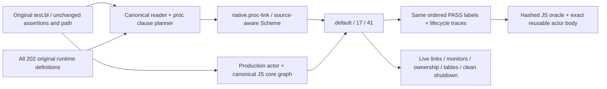

Integrate this directory as `research/native-seed/corpus/`, staged linker as
`src/native/proc-link.bl`, and staged bridges as `bridges.bl`. The values
agent's combined emitter and `host/host-source-frames.scm` are prerequisites.
The ordinary compiler context keeps source frames disabled; this preparer
explicitly enables them for the original actor gate.

Run one producer/check at a time through the immutable SDK wrapper:

```sh
research/native-seed/run run research/native-seed/corpus/prepare.bl \
  research/native-seed/out/compiler-closure \
  research/native-seed/out/original-actor-corpus
```

It emits the exact full program, captured ANF, source/link manifest and
`body.scm`. The body is the byte-exact suffix after the frozen prelude, with
the explicit source-frame host, original boundary sampler, budget witness and
all original runtime/application definitions. The compiler fixpoint driver can
append that same body to each stage's genuine compiled core/rt.

For efficient first-failure diagnosis, `qualify.py --native-only --budget
default` runs just the already emitted complete original source at that
budget. Its status is **observed-not-qualified**; it does not satisfy the full
gate. The runner starts no BL VM or compiler.

Build the independent current JavaScript baseline once:

```sh
research/native-seed/run run research/native-seed/corpus/prepare-js.bl
```

This uses production `bl.js/build!`, its checked content cache, and
`js.actor/build-one`; the old historical `research/js-actors/out/bundle.mjs`
is not an oracle. Then run under the integrator's sequential 2 GiB cgroup:

```sh
python3 research/native-seed/corpus/qualify.py
```

The six native/JS runs each retain the existing 120-second deadline. Repeated
native fixes can pass `--reuse-js`; a cached JS result is accepted only when
every source, emitted module, exact Node executable, witness and log hash is
unchanged. No deadline, source assertion or fairness timeout is adjusted.

Qualification requires identical ordered checks (at least the original 461,
with no missing/duplicate labels), 11 EXIT-PARITY rows, 10 SUP-PARITY rows,
two SUP-TRACE rows, `js-actors: ALL PASS`, actual sampled deaths/links/monitors/
tables, and zero final resource/error counts at all three budgets. Input and
log identities are checked before/after. The native clock is explicitly the
virtual deadline clock; real readiness/FFI and independent-runtime gates remain
separate. The runner makes no direct-C or compiler-fixpoint claim.

One historical target ABI needs explicit admission: the exact-hash original
test source uses `erlang/raise/2` in its separate crash entry and nil as the
third argument of `raise/3`. The JS actor's `BLRaise` captures fresh logical
frames for a missing/non-tuple trace. The linker maps only this exact source's
raise calls to a BL bridge reproducing that envelope projection; tuple traces
remain exact for re-raise. It does not register a universal Erlang raise/2 leaf,
drop the helper, or edit the acceptance source. The manifest records this
projection and its source authority.

`evidence/original-actor-corpus/oracle.json` schema:

```json
{
  "schema": "bl.native.original-actor-oracle",
  "version": 1,
  "status": "complete",
  "application": {"path": "research/js-actors/test.bl", "sha256": "..."},
  "runtime": {"path": "priv/lib/js/actor/runtime.bl", "sha256": "..."},
  "sdk-pin": {},
  "body": {"path": ".../body.scm", "sha256": "..."},
  "inputs": {"/absolute/input": "sha256"},
  "budgets": {
    "default": {"labels": [], "traces": [], "js_log": {"path": "...", "sha256": "..."}, "all_pass": "js-actors: ALL PASS"},
    "17": {},
    "41": {}
  }
}
```

All labels/traces come from the rebuilt JavaScript execution. No corpus run,
VM launch or native compilation was performed by this staging worker.
