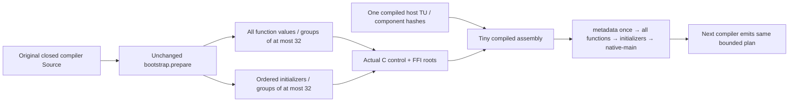

Integrate `c-units.bl`, rewritten `c-bootstrap.bl`/`c-produce.bl`, `c-remote.bl`
and the host/helper files. Closed compiler entries add `native.c`,
`native.c-remote`, `native.c-units`, `native.c-bootstrap`, and selected C eval
adapter. **Do not add SDK-only `native.c-produce` to the image:** its JSON/
resolution dependencies stay on the SDK. The self-image adds no JSON codec,
Rust NIF or replacement Source parser.

The host order is frozen host → C machine → shared raw-function predicate →
static MFAs → external-function weak peeler → dynamic loader → Clang loader →
official Gambit `_digest`/mkdir → late compiler router → pinned configuration.
All components and the aggregate have explicit hashes. Compile the whole host
as one TU. `make_fun/3` still returns its genuine Scheme function and arity;
only the C planner peels a weakly annotated forwarding target. Install that
hook before `rt/seed-core`; Scheme targets during seeding remain callable.

```sh
python3 research/native-seed/direct/prepare-host.py \
  --frozen-host research/native-seed/out/compiler-closure/host.scm
research/native-seed/run run research/native-seed/src/native/c-produce.bl \
  research/native-seed/out/compiler-closure/partition.json \
  research/native-seed/out/direct-compiler \
  research/native-seed/out/direct-host/host.scm \
  research/native-seed/out/direct-host/host.components.json
python3 research/native-seed/direct/build-units.py \
  research/native-seed/out/direct-compiler
```

The final command only admits the fixed ASCII TSV index and hashes; it starts
no compiler. Add `--build` under the existing sequential 2 GiB cgroup for
pinned gsc `-c` → checked startup-symbol adapter → pinned Clang `-O0`.
Each compiler job retains 120 seconds. The tiny assembly executable uses the
qualified Gambit object/link ABI. Objects require exact source, host, headers,
tools, flags, builder and output identities for reuse. The helper runs no
emitted compiler.

Every relative `u0000.scm` keeps c-declare+c-lambda together. Function groups
all load before initializer groups; initialization keeps dependency order,
including `rt/seed-core` at the original core boundary. Metadata installs once.
Final entry is exactly `(native-main (native-command-line))`.

`plan.manifest.scm` uses existing `bootstrap/data` owned constructors; it holds
names, source/body/binding hashes and counts, without copied IR. `index.tsv`
starts `BL_NATIVE_DIRECT_UNITS<TAB>1<TAB>32`, then fixed host/metadata/entry/
assembly/source/unit/definition digest rows. Python hashes Scheme as opaque
bytes and reconstructs the exact assembly to check load order.

Generated C, FFI, manifests and assembly contain no absolute OUT path. Loads
use relative filenames and explicit `BL_NATIVE_C_UNIT_ROOT`. Stage2/stage3
compare those semantic files, not build diagnostics containing cache paths.

```sh
BL_NATIVE_C_UNIT_ROOT=/ABS/out/direct-compiler \
  /ABS/out/direct-compiler/compiler --compile-c \
  /ABS/out/compiler-closure/bundle.scm /ABS/out/direct-host/host.scm \
  /ABS/out/direct-host/host.components.scm /ABS/out/direct-stage2
```

Keep the existing 240-second self-emission deadline. The host routes this
flag through native-global `native.c-bootstrap/main`; no bootstrap dependency
cycle is added. Full direct self-hosting also requires dynamic macro Source
evaluation to select the C eval adapter. The old Scheme eval path is not proof
that macros executed in C.

Required gates: original Source compiler corpus, byte fixpoint, original actor
corpus at default/17/41, and `fixtures/core-forwarding.bl` through the C backend.
The latter tail-calls via actual seeded `core/apply`, checks raw external fun
arity/type, and observes bounded explicit C stack/driver counts. Its stats
reset mutates observation counters only.

Startup IDs `u0000` differ from dynamic loader `unit`, but multiple dynamic
loads still need one-process qualification:

```sh
research/native-seed/run run research/native-seed/direct/loader-produce.bl
python3 research/native-seed/direct/qualify-loader.py \
  --host research/native-seed/out/direct-compiler/host.o1
```

Two C functions must survive the second load independently; a third captures
the first, then survives global rebinding, dropping the original root and GC.
Publication is exactly once per load. The host keeps its three existing
120-second loader deadlines, plus 30 seconds execution/cleanup. A single-load
result cannot qualify this seam.

This worker ran no VM/compiler/test. Independent allocator/collector/
continuation replacement and captured actor resolvers remain separate gates.
