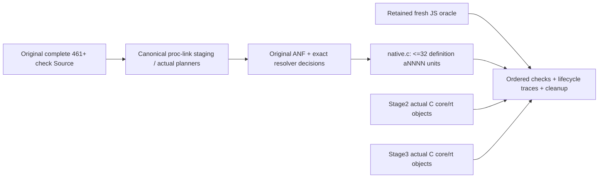

# Original actor corpus through captured direct C control



All code here is staged and unexecuted. `static-audit.json` records only Python
AST and lexical delimiter checks. The parent owns integration and all builds.

Apply the narrow patches, preserving any subsequent parent fixes:

1. `proc-link-capture.patch` records each original ANF global/remote query and
   the existing checked selection while the original staging Env exists.
   `corpus-capture.patch` includes this data in the same ANF artifact and binds
   the artifact hash in the original manifest. No assertion/body is adapted.
2. `c-definition-scopes.patch` adds an actual lowering boundary per definition,
   so a 32-definition unit can retain distinct captured resolver environments.
   The synthetic receive adapter uses the explicit checked rt-receive source.
3. `c-control-frames.patch` follows that patch. Generated loop, receive, try,
   handler and guard controls are logically transparent and inherit the owner
   function/arity. Only loops retain their scheduling tick. Try/catch/finally
   call evidence is non-tail; the existing host barrier still runs finalizers.
   Loops retain the canonical recursion cell/capture and actual C tail calls,
   rather than adding a nonlocal jump across protected control callbacks.
4. `c-units-named-groups.patch` extracts the existing bounded formatter with
   explicit name/options parameters. Its default compiler route is unchanged.
5. Install only `src/native/c-actor-options.bl`, `src/native/c-actor-produce.bl`
   into the canonical native Source directory, and the Python/Scheme support
   files into `research/native-seed/direct/actor/`. The full emitter `.bl`
   comparison copies in this staging directory are for review, not installation.

The actor resolver never discovers a namespace or reinterprets an alias.
Missing queries fail closed. Captured fixed/logical and packed variadic targets
resolve directly to the published body, entering the same C machine. Known
unavailable host leaves are inert references until invocation, preserving
original function_exported guards while refusing actual forbidden calls.

The compiled actor host loads the captured host-proc-link, source-frame ABI,
invariant sampler and original cleanup witness before any C service table.
The control-frame adapter follows JS callSrc's incoming/internal-site rules.
Actual C steps plus actual C rt/invoke, bl-main and application main values are
checked before the final original cleanup witness. Source bodies execute in
C; Gambit supplies managed values, host services and continuation boundaries.

After the original actor artifact and complete JS oracle exist, the integrator
can run the SDK producer once under the existing cap:

```sh
research/native-seed/run run research/native-seed/src/native/c-actor-produce.bl \
  research/native-seed/out/original-actor-corpus/manifest.json \
  research/native-seed/out/direct-actors
```

The following only admits exact prepared inputs; it launches no compiler:

```sh
python3 research/native-seed/direct/actor/build.py \
  research/native-seed/out/direct-actors
```

Adding `--build` sequentially compiles only the new actor host and bounded
actor units via pinned `gsc -c` then Clang, with the qualified public Gambit ABI
and exact single startup-symbol adapter. Reuse the parent's 2 GiB cgroup and
120-second compiler deadlines. It never rebuilds parent core or starts BL.

Once the direct compiler's stage2 and stage3 plans already have successful
bounded build evidence, reuse those exact compiled objects:

```sh
python3 research/native-seed/direct/actor/qualify.py \
  --actors research/native-seed/out/direct-actors \
  --stage stage2=research/native-seed/out/direct-stage2 \
  --stage stage3=research/native-seed/out/direct-stage3 \
  --oracle research/native-seed/evidence/original-actor-corpus/oracle.json
```

Each fresh process loads its selected stage's host exactly once, the compiled
actor services once, bundle metadata once, all compiler and actor function
units, then dependency-ordered compiler and actor initializer units. It omits
only the compiler command-line entry and runs the original actor main. Exact
parent Source-index and metadata hashes must match the actor capture's closed
compiler; no frozen alternate core/prelude is substituted.

Qualification requires both stages at default/17/41, all ordered original PASS
labels (at least461, unique), 11 EXIT-PARITY / 10 SUP-PARITY / 2 SUP-TRACE rows,
ALL PASS, positive observed lifecycle/resource peaks and final zero resources.
Retained JS logs, Source/SDK inputs, C units, objects and generated load entries
are hashed before/after. Per-run deadline remains120 seconds. A focused budget
or single stage yields observation only. No build or JS rerun happens here.

This actor gate does not certify the compiler Source fixpoint, macro dynamic
loader's three-unit retention, forwarding-tail witness, LLVM whole-program
route, independent allocator/GC or an independent runtime. Those remain their
own required gates; the qualifier reports their absence explicitly.
