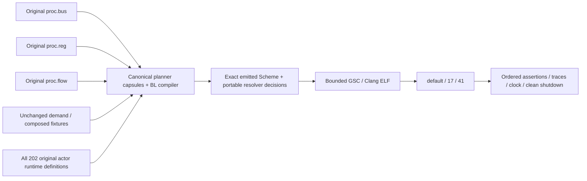

Prepare both helper fixtures in one qualified SDK process:

```sh
research/native-seed/run run research/native-seed/proc/prepare.bl \
  research/native-seed/out/compiler-closure research/native-seed/out/proc-corpora
```

Then build and run one fixture at a time under the integrator's existing
sequential 2 GiB cap:

```sh
python3 research/native-seed/proc/qualify.py research/native-seed/out/proc-corpora/proc-demand \
  --build --standard-bindings --reuse-build research/native-seed/out/compiler-closure/native-build.json
python3 research/native-seed/proc/qualify.py research/native-seed/out/proc-corpora/proc-demand --standard-bindings
python3 research/native-seed/proc/qualify.py research/native-seed/out/proc-corpora/proc-composed \
  --build --standard-bindings --reuse-build research/native-seed/out/compiler-closure/native-build.json
python3 research/native-seed/proc/qualify.py research/native-seed/out/proc-corpora/proc-composed --standard-bindings
```

The existing `build-runtime.bl` interface remains usable; it now also emits a
`.source.json` companion and portable `:link-resolutions` in the ANF artifact.
The qualifier accepts that companion directly and keeps its native outputs in
a separate directory. No fixture, assertion or Source policy is rewritten.

The M1 and M2 drivers share only `native_elf.py`: bounded read/write splitting,
exact tool/flag/environment receipts, optional original core-object reuse,
sequential 120-second compiler/linker children and native ELF construction.
Each driver separately admits its own Source/SDK manifests and observations.
GSI never evaluates authored BL bodies. Existing host C declarations stay in
the frozen indivisible first unit; all later units target 256 KiB with a 1 MiB
hard limit. The SDK producer never runs from either Python qualifier.

M2 checks the exact current fixture hashes, 21/26 ordered PASS labels including
cleanup, all three helper Source identities, the pure bus/registry planner
capsules, six original unit paths, all 202 runtime definitions, complete
portable linker decisions, the immutable SDK and unchanged compiler prefix.
The composed fixture additionally requires actual table ownership activity
and its original three lifecycle traces. Both run at every budget and require
zero actors, monitors, names, tables, runnable entries, input sink, critical
depth and recorded errors.

The standalone clock is explicitly `virtual-turn-ms-v1`: each completed host
turn costs 1ms and existing idle waits retain their behavior. It changes no BL
scheduler/message policy. The witness checks actual completed/yield counts
and elapsed time; the small budgets must actually yield. M1 retains its
separate real monotonic clock and eventfd worker gate.

These are compiled Scheme-to-C helper gates. They establish neither direct
ANF-to-C control nor a compiler fixpoint/independent runtime. Their captured
original ANF and resolver decisions remain available for those later gates.
This staged contribution has only received static source review.
