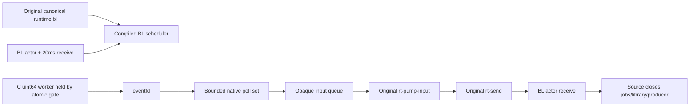

The retained qualification is in `../evidence/real-actors/qualification.json`: 14 checks
at each of the default, 17 and 41 turn budgets, including complete cleanup.

One producer under the qualified SDK:

```sh
research/native-seed/run run research/native-seed/real/prepare.bl \
  research/native-seed/out/compiler-closure research/native-seed/out/real-actors
```

One substantive action at a time, in the integrator's existing 2 GiB cgroup:

```sh
python3 research/native-seed/real/qualify.py research/native-seed/out/real-actors \
  --build --reuse-build research/native-seed/out/compiler-closure/native-build.json
python3 research/native-seed/real/qualify.py research/native-seed/out/real-actors
```

`--reuse-build` is optional. It reuses only hash-identical bounded core objects
with identical ordinals, flags, tools, compiler environment and retained C.
If the retained core used `--standard-bindings`, pass the same explicit option
to both real-actor build and qualification.
The augmented FFI host is compiled as one unit; later units retain 256 KiB
targets and 1 MiB hard bounds. Every compiler, linker and actor child retains
120 seconds. The driver starts no BL VM. GSI only splits Scheme data; the
actors run in the compiled ELF at default/17/41 budgets.

The foreign gate stays closed until Source observes a real peer timer, peer
message and normal monitored death. This establishes overlap without guessing
whether a timed sleep is still running. Source then releases the worker; its
500ms delay leaves the input sink parked so the final eventfd completion must
exercise `host/wait-input`. The gate fails if that path was not actually used.
It also requires positive timed-wait/poll-wake observations and complete BL,
job, library, watch, input and reactor cleanup. A heavily delayed observer can
fail the input-wait observation; the driver does not replace or waive it.

The native producer has no pid or scheduler selection. It accepts at most 64
one-shot completion watches, with bounded scalar tokens, and queues only
`[:ffi-ready token uint64-result]`. Canonical Source registers the input sink
and owns all delivery/timeout/death policy. The existing queue hook also
harvests completions between runnable actor turns. Timed poll returns to the
canonical scheduler to recompute its deadline; an infinite wait without a
registered eventfd fails explicitly.

This gate establishes canonical BL actor progress with real clock/FFI and
readiness on the Gambit native path. It does not establish direct-ANF-C,
compiler fixpoint, or an independent collector/runtime; those remain separate
gates.
