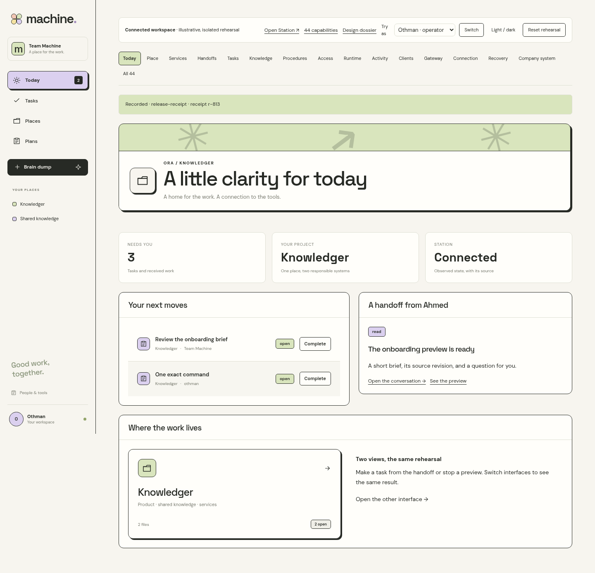
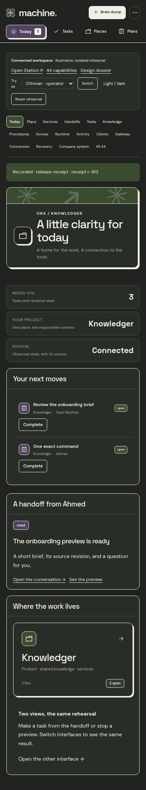
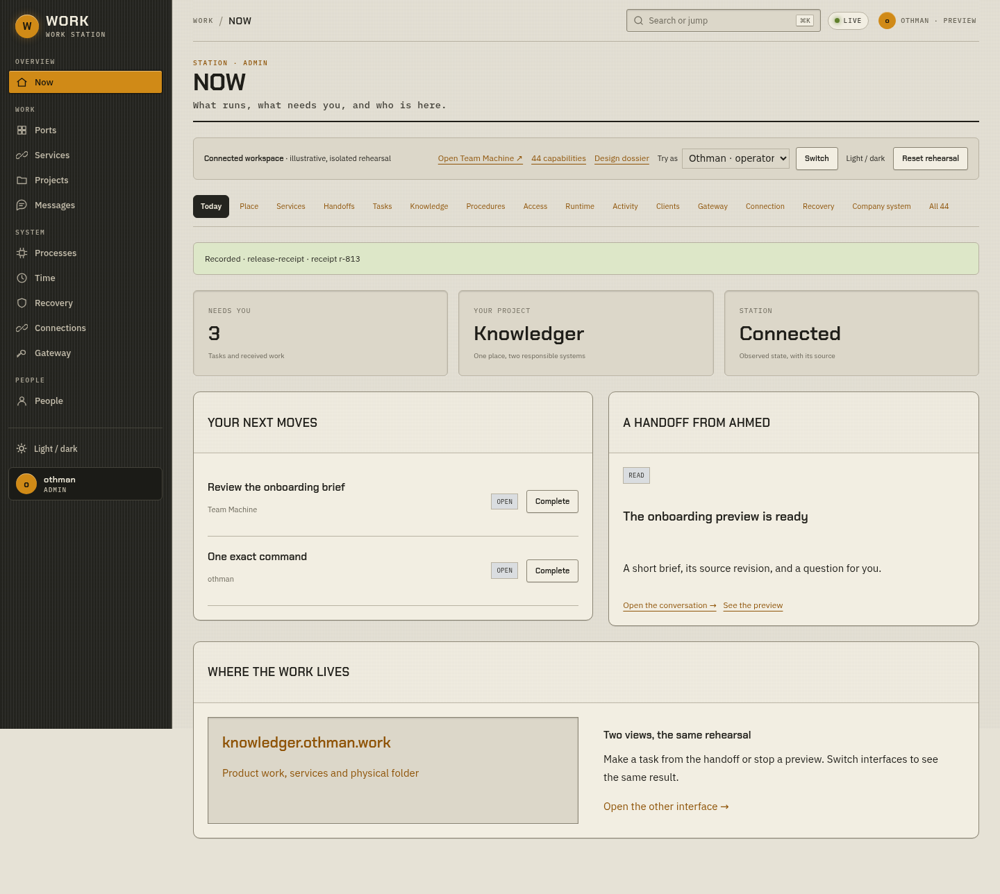
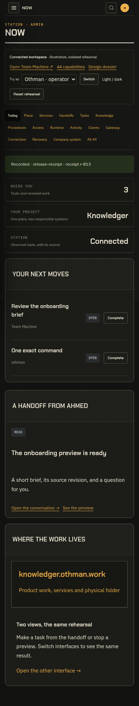
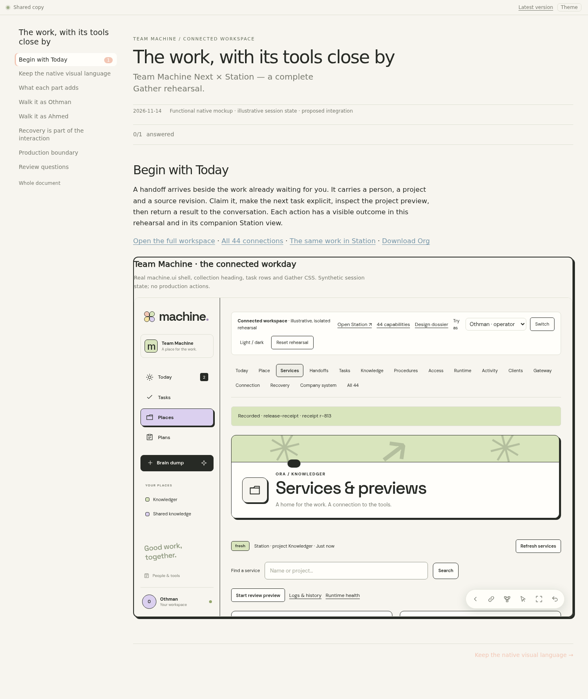
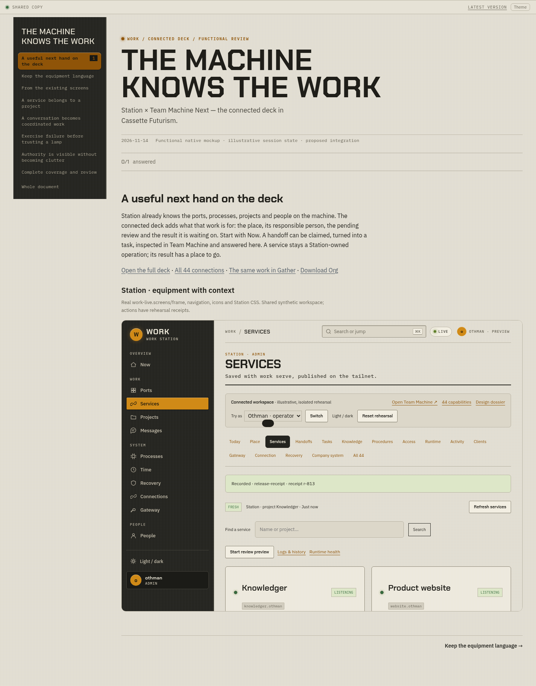

#+title: Connected workspace — two native functional mockups

Three Org dossiers share one bounded review host:

- ../dossiers/integration.bl.org — the complete numbered 44-capability inventory.
- /home/othman/projects/general/team-machine-next/design/station.bl.org — Gather.
- /home/othman/code/products/ora-hub/workstation/dossiers/team-machine.bl.org — Station.

The original Team Machine shell, collection heading, task rows and CSS are loaded
from its declared source root. Station's original frame, icons and CSS come from
its own source root. The existing dossier renderer supplies both embedded screen
graphs. No product UI is copied into this project. This host is a proposal and
rehearsal, not a new implementation of the production integrations.

* Run
From this directory, with the immutable SDK pinned in env.bl:

#+begin_src sh
/nix/store/bq1pgk5rmpp8q40v3yd4x2zzk3cmjwyg-beam-lisp-sdk-selection/bin/bl --cold run serve.bl
#+end_src

The default listener is 127.0.0.1:24136; PORT selects another loopback port.
Open /dossiers/inventory, /dossiers/team, /dossiers/station, /team or /station.
Both product surfaces share a browser-session world. Another browser context
gets a separate world. Sessions expire after two hours and reset on host restart.
The fixture is not durable business storage. Use Reset rehearsal for a fresh take.

* Behavior and boundaries
The finite native writer owns request identity, current role checks, optimistic
revision checks, independent task/triage lifecycles, fixed snapshots, review and
publication state, and operation receipts. Role and connection switches are
explicit fixture controls. Forms require a session nonce and matching Origin.
Failed stale saves retain submitted words. Interrupted invitation replies are
inspected without another execution. A publication retains its source revision.

All state is synthetic. There is no work subprocess, production database, real
filesystem sharing, mesh administration, model call, product invitation, public
publication or root operation. The existing native namespace implementation is
qualified separately; mockup receipts are not production protocol proofs.

features.json owns the complete inventory; both UIs render it directly and the
inventory dossier retains its stable numbers. Connected / Connect / Build are
production implementation states, independent of an interactive mockup.

* Verification
Commit the complete batch before running these checks. Use scripts/bl-mem from
the integration root before any VM, one substantive check at a time, and a capped
transient unit. Native checks execute model invariants, all product views and all
three rendered dossiers in one VM:

#+begin_src sh
/nix/store/bq1pgk5rmpp8q40v3yd4x2zzk3cmjwyg-beam-lisp-sdk-selection/bin/bl --cold test test/rehearsal_test.bl
#+end_src

The browser check uses an isolated loopback listener, a fresh context and the
installed Chromium. It exercises both native shells, actions across them,
permission/failure paths and phone layouts. Evidence and inspected screenshots
are recorded under [[file:../evidence/connected-workspace/qualification.json][the qualification record]]. The final native run passed 116 assertions;
all 15 browser journeys passed across 34 product views, with nine screenshots,
no page errors and no horizontal overflow in the checked layouts.

#+begin_src sh
python3 test/check.py
#+end_src

The harness starts one temporary native VM and closes it and Chromium in cleanup.
Run it under a process-tree memory limit as described above. It never targets a
production listener.

Inspect , ,
 and . The rendered  and
 use the same live screen host rather than image-only mockups.

* Lifecycle
Temporary test listeners and browsers belong to the check harness and are stopped
in cleanup. The intentionally retained private review service is namespace-dossiers,
owned by othman, with a 2G memory ceiling and no boot enablement:

- [[https://work.tailcb5318.ts.net:18141/dossiers/inventory][Complete integration dossier]]
- [[https://work.tailcb5318.ts.net:18141/dossiers/team][Team Machine · Gather dossier and mockup]]
- [[https://work.tailcb5318.ts.net:18141/dossiers/station][Station · Cassette dossier and mockup]]

All six main routes passed local read checks. The published HTTPS route passed
certificate verification and a normal form submission in a fresh synthetic
session. See [[file:../evidence/connected-workspace/review-service.json][the retained service receipt]]. Its only data is the expiring in-memory
fixture. Retire this service after the owner completes the design review.
Use work stop namespace-dossiers to stop it. Native source changes need
work restart namespace-dossiers; Org and stylesheet reads update per request.
Existing application services and production state are unaffected.
