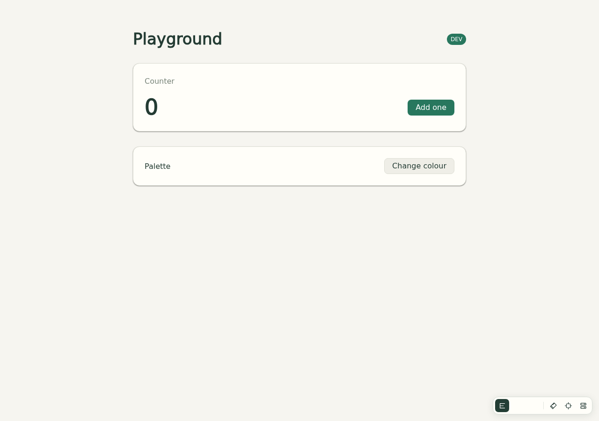
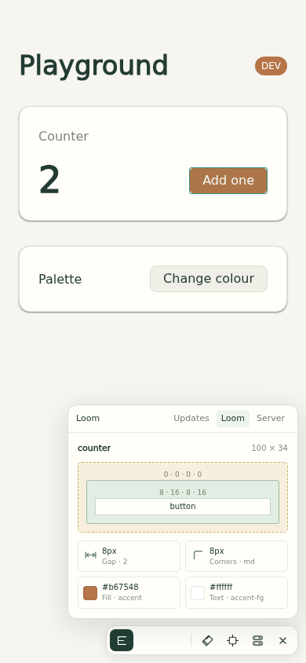
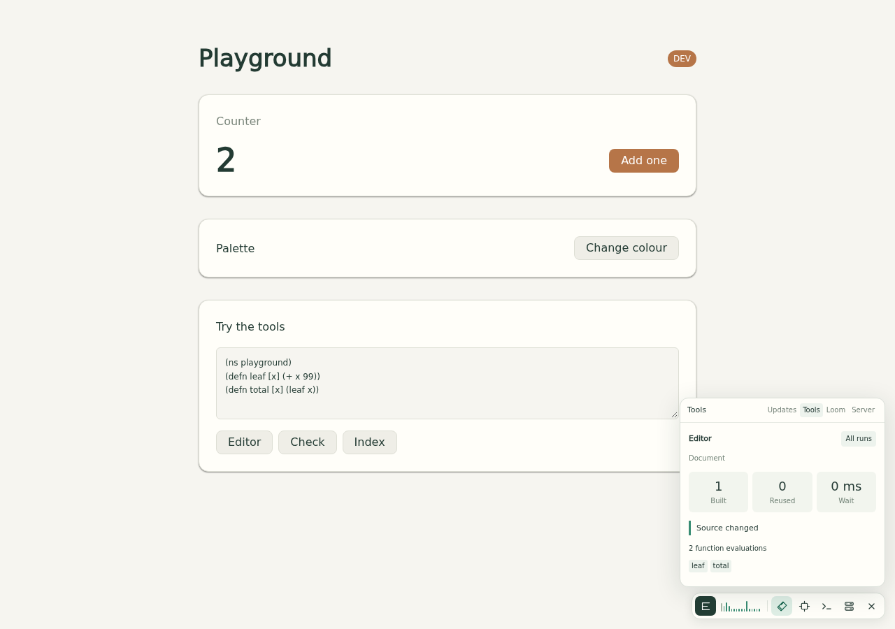
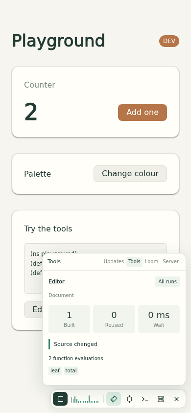

#+title: Work Observatory — implementation roster
#+subtitle: One development surface over Enchant's existing owners.
#+date: 2026-11-17
#+design: forest
#+TODO: TODO NEXT DOING REVIEW | DONE

* Delivery boundary
Work directly in main with one integration writer. Reuse the pinned SDK for
focused source checks. Batch runtime changes before producing a qualified SDK.
No extra worktree, independent telemetry daemon or duplicate resource registry.
See [[file:VISION.bl.org][the dossier]] for the full vision and visual component vocabulary.

#+begin_roster :id observatory-workstreams :source "IMPLEMENTATION.bl.org" :title "Work, made visible" :group-by WORKSTREAM :start WO01 :who "othman codex"
#+end_roster

* Tasks
** DONE WO01 Mount a useful development surface
:PROPERTIES:
:ID: WO01
:WORKSTREAM: First surface
:OWNER: integration
:OUTCOME: An opt-in authorized app mount serves real bounded observations and JSON.
:NEXT_ACTION: Reuse the authorized mount in development apps.
:PROOF: [[file:evidence/acceptance.json][Canonical SDK and browser acceptance]]
:END:
Implement live.observatory open/snapshot/page/handler/attach. Use the existing
app :http composition point and resolved principal. Disabled installation is
inert. Every HTML and JSON read checks host authorization before sampling.
Unknown routes delegate once. Requests cannot select scopes or grants.

** DONE WO02 Observe projection metadata without reading payloads
:PROPERTIES:
:ID: WO02
:WORKSTREAM: First surface
:OWNER: runtime
:OUTCOME: Reader-authorized status returns counters, demand and retention limits without decoding results or acknowledging wakes.
:NEXT_ACTION: Keep metadata reads separate from payload reads and wake acknowledgement.
:PROOF: [[file:evidence/canonical.json][Eight observatory tests and shared runtime regressions]]
:END:
Reuse the projection owner's state and capability checks. Keep source revisions,
queries, values and controller authority out of the observation projection.

** DONE WO03 Make the instruments readable
:PROPERTIES:
:ID: WO03
:WORKSTREAM: First surface
:OWNER: interface
:OUTCOME: A compact injected dock supports update highlighting, read-only Loom picking and bounded server sampling.
:NEXT_ACTION: Connect real editor, check and index counters through WO05/WO06.
:PROOF: [[file:evidence/compact/browser.json][Compact injected dock acceptance]]
:END:
Reuse the injected-chip / Live patch seam from tooling.pulse and studio.js.
Keep 32 update records, one draw per animation frame, sixteen highlight lookups
per frame and one active server request. Hide complexity in tooltips. Read Loom
spacing, colours and corners from the selected element and current theme.
UI edits remain app-owned so they reuse the qualified SDK.

** DONE WO04 Provide example, CLI data and focused evidence
:PROPERTIES:
:ID: WO04
:WORKSTREAM: First surface
:OWNER: integration
:OUTCOME: A runnable app exposes the page; trusted CLI code can emit the same snapshot schema.
:NEXT_ACTION: Reuse the pinned SDK and public snapshot schema.
:PROOF: [[file:evidence/acceptance.json][222 tests, 1609 assertions, browser and CLI evidence]]
:END:
Verify denial before reads, inert disabled mount, route composition, HTML escaping,
JSON shape, truncated lists, stopped owners and repeated no-demand observations.
Stop every test listener and worker in cleanup. Link the resulting receipt.

The [[file:sdk-pin.json][qualified runtime SDK]] retains the original 222-test / 1609-assertion
runtime qualification. The [[file:ui-pin.json][app-owned UI pin]] binds the current dock, adapter and
example to that same runtime. Its [[file:evidence/compact/acceptance.json][acceptance]] passes twenty native assertions
and the real desktop/phone browser checks, including read-only picking, live Loom
theme changes, bounded history/highlights, coalesced drawing, single-flight
sampling, late completion rejection and disposal.

The , [[file:evidence/compact/loom-picker.png][Loom picker]] and  show the deployed
application. [[https://work.tailcb5318.ts.net:4056/][Open the running app]]; the old =/__enchant= link redirects there.
The intended user service remains enabled. The candidate listener on 4057 and
the test browser are stopped. Current UI assets are app-owned and can iterate
without producing another SDK.

** DOING WO05 Activate and trace real workflows
:PROPERTIES:
:ID: WO05
:WORKSTREAM: Operational loop
:OWNER: integration
:OUTCOME: Exact deployed artifacts and end-to-end latency have attributable evidence.
:NEXT_ACTION: Complete activation and sample editor, check, index and dashboard workflows.
:END:
Separate startup, discovery, parse, analyze, query, wait and render costs. Measure
checkout fingerprinting, immutable source capture and artifact production as
separate development-loop phases, so preparation time has an owner too. Qualify
the exact runtime artifact before release; source overlay checks are not release
qualification. Keep native-seed work coordinated with its existing owner.

** DOING WO06 Expose cache and admission evidence
:PROPERTIES:
:ID: WO06
:WORKSTREAM: Instruments
:OWNER: runtime
:OUTCOME: Hit/miss, shared wait, actual computation and slot occupancy come from authoritative bounded counters.
:NEXT_ACTION: Define owner-local counters and a versioned read projection before adding UI gauges.
:END:
No inspection of cache values, global key enumeration, extra polling scheduler or
guessing occupancy from job counts. Cached reads remain available at capacity.
Sampling an inactive tool must not load its compiler/indexer or initialize a cache
merely to count it. Observe already loaded owners through explicit read grants.

** DOING WO07 Explain cause and freshness
:PROPERTIES:
:ID: WO07
:WORKSTREAM: Instruments
:OWNER: tooling
:OUTCOME: A developer can explain why analysis ran and why a retained answer is valid.
:NEXT_ACTION: Define bounded source/revision, invalidation and work-reason receipts.
:END:
Follow the identity → admission → derive → publish chain. Preserve project and
authority boundaries. Bound trace retention and make unavailable history explicit.

** TODO WO08 Add demand-owned live delivery
:PROPERTIES:
:ID: WO08
:WORKSTREAM: Instruments
:OWNER: interface
:OUTCOME: Visible instruments update without accumulating observers or slowing producers.
:NEXT_ACTION: Reuse existing observation subscriptions with capped cadence and teardown.
:END:
Disconnect or hidden-page policy releases demand. Coalesce wakes; no background
sampling without a reader. Test repeated mounts, detach, slow readers and cleanup.

** TODO WO09 Unify program facts across tools
:PROPERTIES:
:ID: WO09
:WORKSTREAM: Shared facts
:OWNER: tooling
:OUTCOME: Editor, check, codebase and ask consume revisioned facts at the precision they need.
:NEXT_ACTION: Audit remaining independent fact producers and document invalidation inputs.
:END:
Retain exact SDK, source, namespace, seeds and modes. Enforce zero recomputation
for unchanged facts and dirty-cone evaluation counts for edits.

** TODO WO10 Migrate expensive application reads
:PROPERTIES:
:ID: WO10
:WORKSTREAM: Owned answers
:OWNER: applications
:OUTCOME: Real dashboards and reports share explicitly owned bounded results.
:NEXT_ACTION: Rank observed hot reads and migrate one representative history or summary.
:END:
Declare lifetime, authorization, demand, limits, staleness and retry policy.
Ten readers of one answer must not create ten derivations.

** TODO WO11 Expand incremental and metered queries
:PROPERTIES:
:ID: WO11
:WORKSTREAM: Incremental engine
:OWNER: runtime
:OUTCOME: Selected joins and grouped summaries update with bounded deltas and recover safely.
:NEXT_ACTION: Specify retained state, deletion semantics, charging and rebuild bounds for one operator.
:END:
Charge before allocation. Refuse unsupported fragments. Verify budget exhaustion
cannot restart another algorithm and incremental results equal bounded rebuilds.

** TODO WO12 Qualify resource contracts and fairness
:PROPERTIES:
:ID: WO12
:WORKSTREAM: Release contracts
:OWNER: integration
:OUTCOME: Interactive/background demand remains fair and downstream releases preserve work bounds.
:NEXT_ACTION: Define mixed-project workloads and exact-artifact operation-count gates.
:END:
Test admission, cancellation, sticky failure, bounded retention, stale completion
rejection and demand removal. Time real workflows separately from deterministic
work-count tests. Extend trusted foreign execution only with runtime support.

** DONE WO13 Make the accepted inspector a standard development option
:PROPERTIES:
:ID: WO13
:WORKSTREAM: First surface
:OWNER: integration
:OUTCOME: Downstream apps opt into the same injected dock through the standard SDK development entrypoint.
:NEXT_ACTION: Adopt the qualified standard :devtools option in downstream applications.
:END:
Preserve the existing SDK observation API and host authorization. Default-off
installation remains inert. Retain per-viewer disposal, shadow DOM isolation,
mount/patch support and the focused work-count browser checks. Do not adopt the
old Pulse process-wide tap or unrestricted state-writing endpoints.

* Current delivery — real tools, explanations, downstream mount
This delivery implements the three agreed next steps. The longer-term WO08–WO12
research programme remains separate. Acceptance uses Enchant namespaces, not an
external browser harness.

** DONE WI01 Record actual editor, check and index work
Bounded opt-in, scope-owned activity records. Preserve execution in the caller,
cache identities and admission limits. Capture real reuse/computation/wait events,
parent relationships and elapsed time. Read-side sampling starts no tool work.
** DONE WI02 Explain selected work visually
Compact tool lanes and selectable runs; show source change, actual reuse/builds,
waiting and child work. Link app updates to their server render. No source bodies,
cache keys or executable values in observations.
** DONE WI03 Make the dock a downstream development option
Ship live.inspector and its assets in the SDK. Enable with live.app/serve :devtools;
default off and host-authorized. Preserve route composition and clean shutdown.
** DONE WI04 Exercise real tools in the playground
Provide small source/editor/check/index actions using the real shared tooling
entry points. Keep tool initialization out of views and observation requests.
** DONE WI05 Qualify behaviour and polish using scenario/browser namespaces
Focused native tests enforce retention bounds, scope isolation, actual cache reuse,
wait accounting, errors and lifecycle. scenario/run-world with browser.page and
browser.film witnesses app actions, selected explanations, Loom, desktop/mobile,
request/paint bounds and disposal. Retain real screenshots and honest verdicts.
** DONE WI06 Pin and deploy
Commit coherent changes, qualify one immutable SDK, bind source and browser
receipts, update the existing tailnet service and leave no temporary listeners.

The committed source preflight [[file:evidence/tools-source-03.json][passes 229 tests / 1737 assertions]].
It includes 105 activity assertions and 23 mount/lifecycle assertions. This is
source qualification on a retained SDK; the exact integrated artifact and
native-browser receipts are still required by WI06.

The final source gate [[file:evidence/tools-source-07.json][passes 232 tests / 1755 assertions]], including cold
first-to-second-call reuse and preserved realm attribution in authorized app
callbacks. Browser acceptance is now exercising the actual source-changing,
invalid-source and late-completion cases before the SDK production batch.

The [[file:evidence/tools-browser-source-03/scenario.json][complete source-preview browser scenario passes fourteen witnessed claims]]
using =scenario=, =browser.page= and =browser.film=. Actual native input and 69 PNG
frames cover source changes, function labels, cold-to-warm reuse, invalid-source
recovery, phone layout, bounded paint/draw work, one sampler, late data rejection
and idempotent disposal. The preview listener and its owned browser are stopped.
One integrated SDK production is now in progress; canonical checks and the same
browser scenario must pass on that artifact before deployment.

Canonical qualification rejected the first integrated candidate on six cold-start
assertions while its other 230 tests passed. This caught lazy admission/worklist/
ANF provider publication that private source compilation had already warmed.
The SDK diagnostic identified the missing providers; readiness now loads them
before evidence capture. The gate remains unchanged. A corrected SDK is being
produced and must pass the original first-to-second-call assertions. Preserve
[[file:evidence/tools-canonical.json][the rejected candidate receipt]] as evidence of this release boundary.

* Accepted delivery
WI01–WI06 are complete. [[file:tools-pin.json][The immutable SDK/application pin]] binds the accepted
[[file:evidence/tools-canonical-02.json][232-test / 1759-assertion canonical qualification]],
[[file:evidence/tools-browser-canonical/acceptance.json][fourteen native browser witnesses]] and
[[file:evidence/tools-deployment.json][exact-asset deployment check]]. The service is enabled at
[[https://work.tailcb5318.ts.net:4056/][the tailnet app]]; refresh an existing tab to load the new dock.

The SDK ships =live.inspector= and its assets. =live.app/serve :devtools= is
default-off, host-authorized and owns its reader lifecycle. Tools displays real
editor/check/index decisions, waiting and evaluated function labels; selected
updates link to their server render. The example includes real tool actions and
recovers from invalid source without losing its app socket.

 ·  · [[file:../../docs/dev/inspector.md][Downstream API and replay command]].
The temporary 4057 listener and all owned browser processes are stopped. No
additional worktree was created. SDK production and qualification reused this
checkout and the existing native backend; the rejected first artifact was never
activated. The corrected artifact passed the original cold-start gate, extended
to full indexing, before deployment. CI isolates that file in its own VM.

WO05–WO07 remain the wider operational programme: real-project adoption,
discovery/startup/production phase attribution, cache-byte/slot-owner observations
and dependency-revision explanations. Their first tool/run instruments are
implemented here. WO08–WO12 remain the longer-term programme described in the
dossier; they are outside this agreed three-feature delivery.

* Station gateway audit recovery baseline

The benchmark calls Station's actual =gateway_data.snapshot= on the recovery
fixture shape. It checks the route totals and both UID scopes in the 7-day and
30-day windows. At 3,000, 30,000 and 74,000 generated audit rows, one append
cost 66 ms, 747 ms and 1,702 ms of median process CPU. The 16-viewer warm burst
started zero audit recoveries at every size and used 56–62 ms of CPU. Peak
process RSS across the 74,000-row replay was 66 MiB. This captures the behavior
a dashboard migration needs to preserve and the history-sized work it needs to
remove when the source advances.
[[file:station-recovery.py][Baseline runner]]
[[file:evidence/station-recovery-baseline.json][Measurements]]

Station's accounting publisher uses one immutable Datom basis for the query,
each fact pull, and the gap count. It groups facts by UID once before building
personal windows. The UID partition now visits the history once instead of
scanning it once per UID. On 3,000 requests across 150 UIDs, median warm work
fell from 468 million to 235 million BEAM reductions. Warm wall time fell from
3.14 s to 1.91 s in the same replay. The full 1,349,491-byte snapshots match
after normalizing clock values and unordered aggregate rows. The current
Station release pin passed 179 accounting assertions, and the Python feed
suite passed 24 tests. The published runtime pin lacks the managed derivation
API, which still needs to be available for the owner migration.
[[file:evidence/station-accounting-publisher-comparison.json][Exact publisher comparison]]

The Station publisher now selects the managed owner when =data.derivation=
is available. The owner streams each window into a private candidate file
and retains a receipt with the input basis, validity deadline, size and hash.
The controller verifies the candidate in 64 KiB chunks before atomically
replacing the report.
An unchanged poll checks the source basis, credentials, deadline and file
identity. It took 2.1 ms in the initial replay and 7.8 ms in the final replay.
A credential change and an appended request both rebuild the report.
The over-budget control preserves the last accepted file and removes its
candidate. The clock regression test checks when the final event ages out
of a user's 31-day history, which removes the empty personal windows.

The generated 3,000-request, 150-UID replay matched the complete 2.16 MB
legacy report after normalizing observation timestamps, the publication ID
and unordered aggregate rows. Ledger timestamps and ordered request
histories match exactly. The actual Python feed served 16 concurrent
readers from the current report and 100 subsequent reads from the stale
retained report after a simulated refusal. It started zero audit recoveries
in either case. The qualified managed SDK passed 187 accounting assertions,
the current Station release passed 185 on the compatibility publisher,
and the Python feed suite passed 26 tests. A changed history still requires
report work across the selected windows.
[[file:evidence/station-managed-accounting.json][Managed publisher replay and qualification]]

For a changed basis, the projection decodes the selected history, visits it
for the two global windows and groups it once for the personal windows.
Station now retains the top 300 requests and top 20 fallbacks as it scans each
window. It preserves the report's reverse input order on equal timestamps.
After each event, each tree holds the largest keys it has seen up to its cap.
A new entry replaces the smallest retained key only if it ranks higher.
For =N= requests and cap =K=, ranking takes =O(N log K)= work and
=O(K)= extra space. The earlier full-window sorts took =O(N log N)= work
in the worst case. Attempt ordering and the remaining report work still run.

Four fresh processes alternated the two implementations in baseline,
candidate, candidate, baseline order. The 30-day projection retained the
same deterministic report bytes at each size. Medians exclude each
process's first sample per size.

| Requests | Projection wall time | Projection BEAM reductions |
|----------+----------------------+----------------------------|
| 3,000 | 101 → 82 ms | 15.6 → 10.3 million |
| 30,000 | 1.20 → 0.74 s | 167.9 → 93.9 million |
| 74,000 | 3.34 → 1.85 s | 431.9 → 229.5 million |

The real snapshot runner over 3,000 requests and 150 users confirmed the
report's window totals and per-user scope. Warm medians fell from 912 to
853 ms and from 112.4 to 95.7 million reductions. The accounting suite passed
189 assertions on the managed SDK and 187 on Station's release. Writing and
checking a complete report of =B= bytes still take =Θ(B)=.
[[file:evidence/station-bounded-report-ranking.json][Report ranking, snapshot timings and exact qualification]]

The next delta experiment can capture committed changes during import, using
the connection basis to detect an unknown producer or missed transaction.
Use bounded expiry and reversible aggregates for counts and meters. Keep
request-ID joins and top-request ordering in the parity comparison, including
an attempt finish that replaces its start, equal timestamps, and a fact
expiring from one window while remaining in the other. Measure preparation
separately from serialization at 3,000, 30,000 and 74,000 rows. Until the
complete report format changes, reuse unchanged serialized user windows and
count the bytes written and verified as a separate cost.

The Station window model proves that replacing a committed fact subtracts
its old contribution and adds its new one independently in each group. A
clock advance subtracts precisely the contributions that cross the new
cutoff. A fact at the cutoff remains visible. The Station replay checks
these rules against the reference publisher's request counts, refusals,
token totals and fallbacks. The model covers these additive counters.
Report ordering, joins and serialization have separate runtime checks.
[[file:StationWindow.lean][Window counter proof]]

The 3,000-request replay used committed transaction reports from the
actual Station schema on the checkout SDK. Applying three changed facts
used 1.40 million caller reductions. Rebuilding the fact index used 58.43
million. Retaining decoded facts while preserving the existing history
query order took 19.23 million reductions on average, compared with 44.03
million for full pulls. The reference and candidate produced the same
ordered events and complete 7- and 30-day report maps, including the
completed attempt join and the two checked UID scopes.

The isolated counter update expired 300 requests from the 7-day window
and zero from the 30-day window. Request counts, refusals, token totals
and fallbacks matched the reference in both. The cursor-only commit had
no changed facts. An overtaken or missed report took the full-rebuild
path. The full report still runs the reference ordering and serialization.
[[file:evidence/station-transaction-delta-3000.json][Exact 3,000-request replay]]

At 30,000 requests, the same three changed facts took 1.42 million caller
reductions, compared with 579.71 million for the complete index rebuild.
Retained history preparation averaged 189.66 million reductions versus
441.86 million for full pulls. The ordered event vector, both complete window
maps and the individual windows for the two checked UIDs matched. The
counter replay expired 3,000 requests from the 7-day window and zero from
the 30-day window. The measured history path still queries the complete
selection to preserve tie ordering. These timings cover transaction delta
and history preparation. The full publisher's writes and checks remain
separate stages.
[[file:evidence/station-transaction-delta-30000.json][Exact 30,000-request replay]]

The 74,000-request replay seeded its owned fixture in 27.44 seconds and used
ordinary transactions for all subsequent changes. The committed delta
processed three facts in 1.52 million caller reductions, compared with
1,420.77 million for the complete index rebuild. Retained event preparation
averaged 465.89 million reductions versus 1,084.27 million for full pulls.
All 74,003 ordered events, both complete window maps and the two checked UID
scopes matched. The cursor-only and missed-basis controls passed. Expiry
removed 7,400 requests from the 7-day window and zero from the 30-day window.
[[file:evidence/station-transaction-delta-bulk-74000.json][Exact 74,000-request replay]]

Run the replay with =--complete-report= to test reuse at a fixed observation
time with no billing overrides. It uses Station's ordered facts, gap count,
window projector and JSON encoder. A UID's encoded windows are reusable only
when no changed fact belongs to that UID and its ordered event input still
matches. The probe requires byte-identical complete output and measures UID
selection, global and UID shaping, encoding, file writes and reader hashing
separately. Its private file check observes the managed publisher's 16 MiB
limit. It also records the total encoded UID payload kept by the fixture and
the portion reused by the next report. Each run still walks the selected
history and writes =Θ(B)= report bytes.
With =N= selected events, old and new ordered inputs require =O(N)= work to
compare across the current UID partition. The candidate replaces user window
rendering and JSON encoding with recomputation for the dirty UIDs and a
lookup for each reused UID. The global windows still run independently.
The Lean proof covers composition when cached bytes came from the exact old
ordered list and both encoder contexts match. The running probe checks those
premises at a fixed clock on pinned Gateway Source. The publisher must
revalidate context after a clock, billing or code revision.
[[file:StationWindow.lean][Exact ordered window reuse proof]]

At 3,000 requests the complete probe wrote and checked identical
1,912,213-byte reports. It reshaped two UIDs and reused 148 of 150 encoded
windows. The retained payload was 1,634,434 bytes and 1,614,392 of those
bytes were reused. UID projection fell from 25.27 million to 0.37 million
caller reductions. The global windows still used about 21 million reductions
in each arm. The run holds the observation time fixed and uses Station's
pure projector and JSON encoder. Production needs to account for the
retained bytes and invalidate windows as their context changes.
[[file:evidence/station-complete-report-3000.json][Complete Station publication at 3,000 requests]]

At 30,000 requests the complete verified report occupied 14,010,897 bytes.
The probe again reused 148 of 150 UID windows. UID projection took 217.16
million caller reductions for the full run and 2.48 million with reuse.
Keeping the encoded windows took 13,728,402 bytes. Global shaping still used
about 200 million reductions in the retained path. This run held the clock
fixed. The separate =--clock-reuse= probe checks whether shaped windows can
be restamped and encoded after the clock advances. It uses Station's deadline,
compares each UID's ordered events and charges retained rows with the SDK's
footprint function. Expiry, rollback and a zero budget exercise fresh shaping.
[[file:evidence/station-complete-report-30000.json][Complete Station publication at 30,000 requests]]
