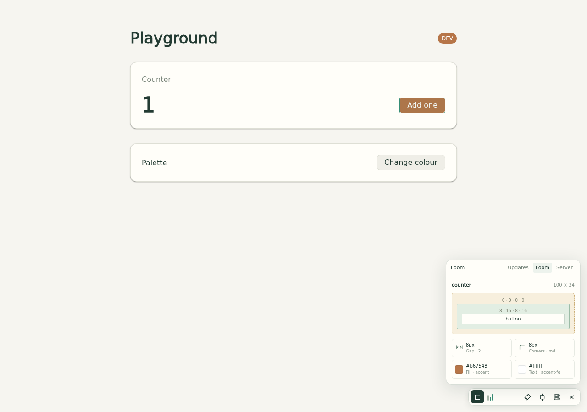

#+title: Work Observatory — implementation roster
#+subtitle: One development surface over Enchant's existing owners.
#+date: 2026-11-17
#+design: forest
#+TODO: TODO NEXT DOING REVIEW | DONE

* Delivery boundary
Work directly in main with one integration writer. Reuse the pinned SDK for
focused source checks. Batch runtime changes before producing a qualified SDK.
No extra worktree, independent telemetry daemon or duplicate resource registry.
See [[file:VISION.bl.org][the dossier]] for the full vision and visual component vocabulary.

#+begin_roster :id observatory-workstreams :source "IMPLEMENTATION.bl.org" :title "Work, made visible" :group-by WORKSTREAM :start WO01 :who "othman codex"
#+end_roster

* Tasks
** DONE WO01 Mount a useful development surface
:PROPERTIES:
:ID: WO01
:WORKSTREAM: First surface
:OWNER: integration
:OUTCOME: An opt-in authorized app mount serves real bounded observations and JSON.
:NEXT_ACTION: Reuse the authorized mount in development apps.
:PROOF: [[file:evidence/acceptance.json][Canonical SDK and browser acceptance]]
:END:
Implement live.observatory open/snapshot/page/handler/attach. Use the existing
app :http composition point and resolved principal. Disabled installation is
inert. Every HTML and JSON read checks host authorization before sampling.
Unknown routes delegate once. Requests cannot select scopes or grants.

** DONE WO02 Observe projection metadata without reading payloads
:PROPERTIES:
:ID: WO02
:WORKSTREAM: First surface
:OWNER: runtime
:OUTCOME: Reader-authorized status returns counters, demand and retention limits without decoding results or acknowledging wakes.
:NEXT_ACTION: Keep metadata reads separate from payload reads and wake acknowledgement.
:PROOF: [[file:evidence/canonical.json][Eight observatory tests and shared runtime regressions]]
:END:
Reuse the projection owner's state and capability checks. Keep source revisions,
queries, values and controller authority out of the observation projection.

** DONE WO03 Make the instruments readable
:PROPERTIES:
:ID: WO03
:WORKSTREAM: First surface
:OWNER: interface
:OUTCOME: A compact injected dock supports update highlighting, read-only Loom picking and bounded server sampling.
:NEXT_ACTION: Connect real editor, check and index counters through WO05/WO06.
:PROOF: [[file:evidence/compact/browser.json][Compact injected dock acceptance]]
:END:
Reuse the injected-chip / Live patch seam from tooling.pulse and studio.js.
Keep 32 update records, one draw per animation frame, sixteen highlight lookups
per frame and one active server request. Hide complexity in tooltips. Read Loom
spacing, colours and corners from the selected element and current theme.
UI edits remain app-owned so they reuse the qualified SDK.

** DONE WO04 Provide example, CLI data and focused evidence
:PROPERTIES:
:ID: WO04
:WORKSTREAM: First surface
:OWNER: integration
:OUTCOME: A runnable app exposes the page; trusted CLI code can emit the same snapshot schema.
:NEXT_ACTION: Reuse the pinned SDK and public snapshot schema.
:PROOF: [[file:evidence/acceptance.json][222 tests, 1609 assertions, browser and CLI evidence]]
:END:
Verify denial before reads, inert disabled mount, route composition, HTML escaping,
JSON shape, truncated lists, stopped owners and repeated no-demand observations.
Stop every test listener and worker in cleanup. Link the resulting receipt.

The [[file:sdk-pin.json][qualified runtime SDK]] retains the original 222-test / 1609-assertion
runtime qualification. The [[file:ui-pin.json][app-owned UI pin]] binds the current dock, adapter and
example to that same runtime. Its [[file:evidence/compact/acceptance.json][acceptance]] passes twenty native assertions
and the real desktop/phone browser checks, including read-only picking, live Loom
theme changes, bounded history/highlights, coalesced drawing, single-flight
sampling, late completion rejection and disposal.

The [[file:evidence/compact/desktop.png][collapsed dock]],  and [[file:evidence/compact/mobile.png][phone view]] show the deployed
application. [[https://work.tailcb5318.ts.net:4056/][Open the running app]]; the old =/__enchant= link redirects there.
The intended user service remains enabled. The candidate listener on 4057 and
the test browser are stopped. Current UI assets are app-owned and can iterate
without producing another SDK.

** NEXT WO05 Activate and trace real workflows
:PROPERTIES:
:ID: WO05
:WORKSTREAM: Operational loop
:OWNER: integration
:OUTCOME: Exact deployed artifacts and end-to-end latency have attributable evidence.
:NEXT_ACTION: Complete activation and sample editor, check, index and dashboard workflows.
:END:
Separate startup, discovery, parse, analyze, query, wait and render costs. Measure
checkout fingerprinting, immutable source capture and artifact production as
separate development-loop phases, so preparation time has an owner too. Qualify
the exact runtime artifact before release; source overlay checks are not release
qualification. Keep native-seed work coordinated with its existing owner.

** TODO WO06 Expose cache and admission evidence
:PROPERTIES:
:ID: WO06
:WORKSTREAM: Instruments
:OWNER: runtime
:OUTCOME: Hit/miss, shared wait, actual computation and slot occupancy come from authoritative bounded counters.
:NEXT_ACTION: Define owner-local counters and a versioned read projection before adding UI gauges.
:END:
No inspection of cache values, global key enumeration, extra polling scheduler or
guessing occupancy from job counts. Cached reads remain available at capacity.
Sampling an inactive tool must not load its compiler/indexer or initialize a cache
merely to count it. Observe already loaded owners through explicit read grants.

** TODO WO07 Explain cause and freshness
:PROPERTIES:
:ID: WO07
:WORKSTREAM: Instruments
:OWNER: tooling
:OUTCOME: A developer can explain why analysis ran and why a retained answer is valid.
:NEXT_ACTION: Define bounded source/revision, invalidation and work-reason receipts.
:END:
Follow the identity → admission → derive → publish chain. Preserve project and
authority boundaries. Bound trace retention and make unavailable history explicit.

** TODO WO08 Add demand-owned live delivery
:PROPERTIES:
:ID: WO08
:WORKSTREAM: Instruments
:OWNER: interface
:OUTCOME: Visible instruments update without accumulating observers or slowing producers.
:NEXT_ACTION: Reuse existing observation subscriptions with capped cadence and teardown.
:END:
Disconnect or hidden-page policy releases demand. Coalesce wakes; no background
sampling without a reader. Test repeated mounts, detach, slow readers and cleanup.

** TODO WO09 Unify program facts across tools
:PROPERTIES:
:ID: WO09
:WORKSTREAM: Shared facts
:OWNER: tooling
:OUTCOME: Editor, check, codebase and ask consume revisioned facts at the precision they need.
:NEXT_ACTION: Audit remaining independent fact producers and document invalidation inputs.
:END:
Retain exact SDK, source, namespace, seeds and modes. Enforce zero recomputation
for unchanged facts and dirty-cone evaluation counts for edits.

** TODO WO10 Migrate expensive application reads
:PROPERTIES:
:ID: WO10
:WORKSTREAM: Owned answers
:OWNER: applications
:OUTCOME: Real dashboards and reports share explicitly owned bounded results.
:NEXT_ACTION: Rank observed hot reads and migrate one representative history or summary.
:END:
Declare lifetime, authorization, demand, limits, staleness and retry policy.
Ten readers of one answer must not create ten derivations.

** TODO WO11 Expand incremental and metered queries
:PROPERTIES:
:ID: WO11
:WORKSTREAM: Incremental engine
:OWNER: runtime
:OUTCOME: Selected joins and grouped summaries update with bounded deltas and recover safely.
:NEXT_ACTION: Specify retained state, deletion semantics, charging and rebuild bounds for one operator.
:END:
Charge before allocation. Refuse unsupported fragments. Verify budget exhaustion
cannot restart another algorithm and incremental results equal bounded rebuilds.

** TODO WO12 Qualify resource contracts and fairness
:PROPERTIES:
:ID: WO12
:WORKSTREAM: Release contracts
:OWNER: integration
:OUTCOME: Interactive/background demand remains fair and downstream releases preserve work bounds.
:NEXT_ACTION: Define mixed-project workloads and exact-artifact operation-count gates.
:END:
Test admission, cancellation, sticky failure, bounded retention, stale completion
rejection and demand removal. Time real workflows separately from deterministic
work-count tests. Extend trusted foreign execution only with runtime support.

** TODO WO13 Make the accepted inspector a standard development option
:PROPERTIES:
:ID: WO13
:WORKSTREAM: First surface
:OWNER: integration
:OUTCOME: Downstream apps opt into the same injected dock through the standard SDK development entrypoint.
:NEXT_ACTION: Settle the app-owned UI, then promote its adapter with one SDK batch while keeping view assets independently editable.
:END:
Preserve the existing SDK observation API and host authorization. Default-off
installation remains inert. Retain per-viewer disposal, shadow DOM isolation,
mount/patch support and the focused work-count browser checks. Do not adopt the
old Pulse process-wide tap or unrestricted state-writing endpoints.

* Current delivery — real tools, explanations, downstream mount
This delivery implements the three agreed next steps. The longer-term WO08–WO12
research programme remains separate. Acceptance uses Enchant namespaces, not an
external browser harness.

** DONE WI01 Record actual editor, check and index work
Bounded opt-in, scope-owned activity records. Preserve execution in the caller,
cache identities and admission limits. Capture real reuse/computation/wait events,
parent relationships and elapsed time. Read-side sampling starts no tool work.
** REVIEW WI02 Explain selected work visually
Compact tool lanes and selectable runs; show source change, actual reuse/builds,
waiting and child work. Link app updates to their server render. No source bodies,
cache keys or executable values in observations.
** REVIEW WI03 Make the dock a downstream development option
Ship live.inspector and its assets in the SDK. Enable with live.app/serve :devtools;
default off and host-authorized. Preserve route composition and clean shutdown.
** REVIEW WI04 Exercise real tools in the playground
Provide small source/editor/check/index actions using the real shared tooling
entry points. Keep tool initialization out of views and observation requests.
** DOING WI05 Qualify behaviour and polish using scenario/browser namespaces
Focused native tests enforce retention bounds, scope isolation, actual cache reuse,
wait accounting, errors and lifecycle. scenario/run-world with browser.page and
browser.film witnesses app actions, selected explanations, Loom, desktop/mobile,
request/paint bounds and disposal. Retain real screenshots and honest verdicts.
** TODO WI06 Pin and deploy
Commit coherent changes, qualify one immutable SDK, bind source and browser
receipts, update the existing tailnet service and leave no temporary listeners.

The committed source preflight [[file:evidence/tools-source-03.json][passes 229 tests / 1737 assertions]].
It includes 105 activity assertions and 23 mount/lifecycle assertions. This is
source qualification on a retained SDK; the exact integrated artifact and
native-browser receipts are still required by WI06.
