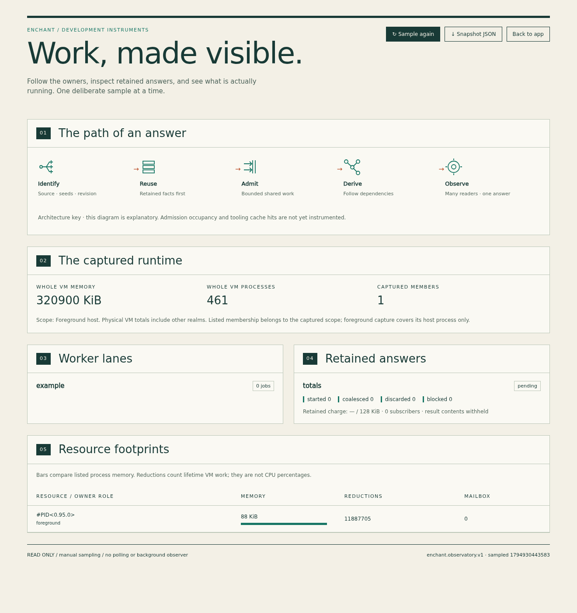
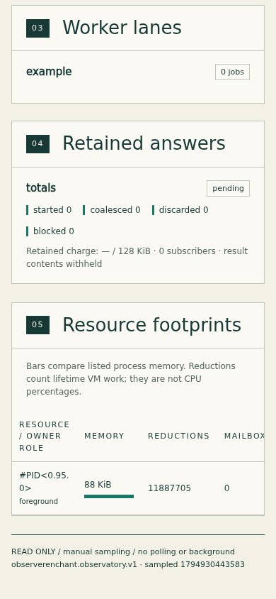

#+title: Work Observatory — implementation roster
#+subtitle: One development surface over Enchant's existing owners.
#+date: 2026-11-17
#+design: forest
#+TODO: TODO NEXT DOING REVIEW | DONE

* Delivery boundary
Work directly in main with one integration writer. Reuse the pinned SDK for
focused source checks. Batch runtime changes before producing a qualified SDK.
No extra worktree, independent telemetry daemon or duplicate resource registry.
See [[file:VISION.bl.org][the dossier]] for the full vision and visual component vocabulary.

#+begin_roster :id observatory-workstreams :source "IMPLEMENTATION.bl.org" :title "Work, made visible" :group-by WORKSTREAM :start WO01 :who "othman codex"
#+end_roster

* Tasks
** DONE WO01 Mount a useful development surface
:PROPERTIES:
:ID: WO01
:WORKSTREAM: First surface
:OWNER: integration
:OUTCOME: An opt-in authorized app mount serves real bounded observations and JSON.
:NEXT_ACTION: Reuse the authorized mount in development apps.
:PROOF: [[file:evidence/acceptance.json][Canonical SDK and browser acceptance]]
:END:
Implement live.observatory open/snapshot/page/handler/attach. Use the existing
app :http composition point and resolved principal. Disabled installation is
inert. Every HTML and JSON read checks host authorization before sampling.
Unknown routes delegate once. Requests cannot select scopes or grants.

** DONE WO02 Observe projection metadata without reading payloads
:PROPERTIES:
:ID: WO02
:WORKSTREAM: First surface
:OWNER: runtime
:OUTCOME: Reader-authorized status returns counters, demand and retention limits without decoding results or acknowledging wakes.
:NEXT_ACTION: Keep metadata reads separate from payload reads and wake acknowledgement.
:PROOF: [[file:evidence/canonical.json][Eight observatory tests and shared runtime regressions]]
:END:
Reuse the projection owner's state and capability checks. Keep source revisions,
queries, values and controller authority out of the observation projection.

** DOING WO03 Make the instruments readable
:PROPERTIES:
:ID: WO03
:WORKSTREAM: First surface
:OWNER: interface
:OUTCOME: A compact injected dock supports update highlighting, read-only Loom picking and bounded server sampling.
:NEXT_ACTION: Qualify the app-owned dock, deploy it on the existing tailnet route, then connect real tooling counters.
:PROOF: [[file:evidence/compact/browser.json][Compact injected dock acceptance]]
:END:
Reuse the injected-chip / Live patch seam from tooling.pulse and studio.js.
Keep 32 update records, one draw per animation frame, sixteen highlight lookups
per frame and one active server request. Hide complexity in tooltips. Read Loom
spacing, colours and corners from the selected element and current theme.
UI edits remain app-owned so they reuse the qualified SDK.

** DONE WO04 Provide example, CLI data and focused evidence
:PROPERTIES:
:ID: WO04
:WORKSTREAM: First surface
:OWNER: integration
:OUTCOME: A runnable app exposes the page; trusted CLI code can emit the same snapshot schema.
:NEXT_ACTION: Reuse the pinned SDK and public snapshot schema.
:PROOF: [[file:evidence/acceptance.json][222 tests, 1609 assertions, browser and CLI evidence]]
:END:
Verify denial before reads, inert disabled mount, route composition, HTML escaping,
JSON shape, truncated lists, stopped owners and repeated no-demand observations.
Stop every test listener and worker in cleanup. Link the resulting receipt.

The [[file:sdk-pin.json][qualified SDK pin]] records the artifact and source hashes. The canonical
receipt matches thirty consumer sources against that image and runs twenty-eight
original test files. Browser acceptance covers app-to-observatory navigation,
five native SVG diagrams, manual resampling, JSON export and narrow layout.
The  and  captures show the actual served application.
The temporary listener and browser were disposed after capture; port 4056 was
verified released. These are local development-surface checks, not workstation
service activation or a published rolling release.

** NEXT WO05 Activate and trace real workflows
:PROPERTIES:
:ID: WO05
:WORKSTREAM: Operational loop
:OWNER: integration
:OUTCOME: Exact deployed artifacts and end-to-end latency have attributable evidence.
:NEXT_ACTION: Complete activation and sample editor, check, index and dashboard workflows.
:END:
Separate startup, discovery, parse, analyze, query, wait and render costs. Measure
checkout fingerprinting, immutable source capture and artifact production as
separate development-loop phases, so preparation time has an owner too. Qualify
the exact runtime artifact before release; source overlay checks are not release
qualification. Keep native-seed work coordinated with its existing owner.

** TODO WO06 Expose cache and admission evidence
:PROPERTIES:
:ID: WO06
:WORKSTREAM: Instruments
:OWNER: runtime
:OUTCOME: Hit/miss, shared wait, actual computation and slot occupancy come from authoritative bounded counters.
:NEXT_ACTION: Define owner-local counters and a versioned read projection before adding UI gauges.
:END:
No inspection of cache values, global key enumeration, extra polling scheduler or
guessing occupancy from job counts. Cached reads remain available at capacity.
Sampling an inactive tool must not load its compiler/indexer or initialize a cache
merely to count it. Observe already loaded owners through explicit read grants.

** TODO WO07 Explain cause and freshness
:PROPERTIES:
:ID: WO07
:WORKSTREAM: Instruments
:OWNER: tooling
:OUTCOME: A developer can explain why analysis ran and why a retained answer is valid.
:NEXT_ACTION: Define bounded source/revision, invalidation and work-reason receipts.
:END:
Follow the identity → admission → derive → publish chain. Preserve project and
authority boundaries. Bound trace retention and make unavailable history explicit.

** TODO WO08 Add demand-owned live delivery
:PROPERTIES:
:ID: WO08
:WORKSTREAM: Instruments
:OWNER: interface
:OUTCOME: Visible instruments update without accumulating observers or slowing producers.
:NEXT_ACTION: Reuse existing observation subscriptions with capped cadence and teardown.
:END:
Disconnect or hidden-page policy releases demand. Coalesce wakes; no background
sampling without a reader. Test repeated mounts, detach, slow readers and cleanup.

** TODO WO09 Unify program facts across tools
:PROPERTIES:
:ID: WO09
:WORKSTREAM: Shared facts
:OWNER: tooling
:OUTCOME: Editor, check, codebase and ask consume revisioned facts at the precision they need.
:NEXT_ACTION: Audit remaining independent fact producers and document invalidation inputs.
:END:
Retain exact SDK, source, namespace, seeds and modes. Enforce zero recomputation
for unchanged facts and dirty-cone evaluation counts for edits.

** TODO WO10 Migrate expensive application reads
:PROPERTIES:
:ID: WO10
:WORKSTREAM: Owned answers
:OWNER: applications
:OUTCOME: Real dashboards and reports share explicitly owned bounded results.
:NEXT_ACTION: Rank observed hot reads and migrate one representative history or summary.
:END:
Declare lifetime, authorization, demand, limits, staleness and retry policy.
Ten readers of one answer must not create ten derivations.

** TODO WO11 Expand incremental and metered queries
:PROPERTIES:
:ID: WO11
:WORKSTREAM: Incremental engine
:OWNER: runtime
:OUTCOME: Selected joins and grouped summaries update with bounded deltas and recover safely.
:NEXT_ACTION: Specify retained state, deletion semantics, charging and rebuild bounds for one operator.
:END:
Charge before allocation. Refuse unsupported fragments. Verify budget exhaustion
cannot restart another algorithm and incremental results equal bounded rebuilds.

** TODO WO12 Qualify resource contracts and fairness
:PROPERTIES:
:ID: WO12
:WORKSTREAM: Release contracts
:OWNER: integration
:OUTCOME: Interactive/background demand remains fair and downstream releases preserve work bounds.
:NEXT_ACTION: Define mixed-project workloads and exact-artifact operation-count gates.
:END:
Test admission, cancellation, sticky failure, bounded retention, stale completion
rejection and demand removal. Time real workflows separately from deterministic
work-count tests. Extend trusted foreign execution only with runtime support.
