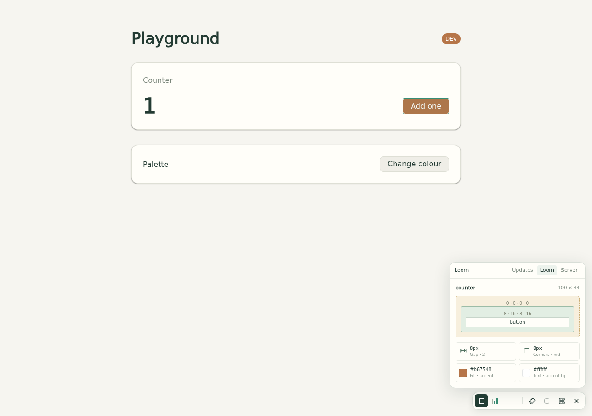
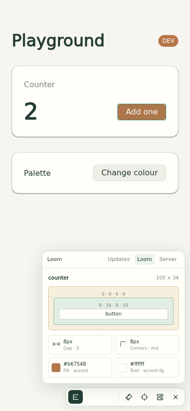

#+title: Work, made visible
#+subtitle: Shared facts, owned answers and an observable resource contract for Enchant.
#+date: 2026-11-17
#+status: Compact in-app inspector; wider programme planned
#+design: forest

* The destination
#+begin_lede
An Enchant application's resource use follows meaningful changes in its data,
rather than how often people look at it. Developers can see which owner is
working, why its answer is current, and which limit stopped it.
#+end_lede

Open ten dashboard tabs: they share maintained answers. Ask the editor, bl check
and codebase about the same program: they reuse compatible facts. Change one
function: analysis follows affected dependencies. Exceed a computation budget:
the owner publishes an explicit status; readers cannot restart it indefinitely.

The [[file:IMPLEMENTATION.bl.org][implementation roster]] separates the working development surface from the
larger runtime programme. Runtime and UI acceptance have independent evidence.
The [[file:evidence/acceptance.json][runtime acceptance]] binds the canonical tests to the [[file:sdk-pin.json][qualified SDK]].
The [[file:evidence/compact/acceptance.json][current UI acceptance]] and [[file:ui-pin.json][UI pin]] cover the injected dock. Preview the
 and .

* The pipeline
| Stage | Responsibility | Evidence |
|-------+----------------+----------|
| Identify | Capture exact source, namespace, seeds, mode, code and SDK | Qualified input identity |
| Reuse | Read compatible retained facts before admission | Hit or explicit miss |
| Admit | Bound concurrent work, waiting and lifetime | Owner and admission outcome |
| Derive | Follow dependencies and reserve work before costly operations | Actual work counters |
| Publish | Make complete, current answers visible | Revision and publication result |
| Observe | Serve many readers without restarting work | Freshness, demand and status |

Unknown evidence declines reuse. Effects and mutable connections keep their
original owners. A shared pure result does not merge callbacks or grant access.
Optional caches can evict and recompute; owned projections offer stronger demand,
retry and sticky-refusal contracts. Arbitrary callbacks retain a trust boundary.

* Six horizons
** Close the workstation loop
Activate qualified changes and measure real editor sessions, repository checks,
indexing and dashboards. Attribute startup, file discovery, parsing, analysis,
database reads, admission waits and rendering separately. Measure native startup
work independently of the analysis pipeline. Every CPU incident needs an owner,
operation and reason, rather than a guessed percentage from one sample.

** Give developer tools common facts
Build a revisioned program model of definitions, references, types, effects,
dependencies and diagnostics. Consumers request the precision they need. An edit
updates affected facts. Dependency and invalidation contracts bound retention and
explain freshness. Sharing respects project and execution-authority boundaries.

** Make expensive application reads owned
Declare derived answers in application owners that outlive screens. Screens
receive readers; subscriptions establish demand. Controllers schedule, publish,
retry and retire workers. Migrate dashboard histories, usage totals, search
summaries and database-wide reports as concrete consumers of the common API.

** Maintain more results incrementally
Extend bounded count/sum and dependency-driven analysis toward selected grouped
summaries, joins and reusable arrangements. Each addition declares retained
state, update cost, deletion behavior, recovery and a bounded rebuild path.

** Put resource contracts beside inputs
Describe work, intermediate memory, retained output, deadlines and retry policy.
Evolve admission toward fairness between projects and interactive/background
demand. Extend managed queries only when reads, allocations and cancellation can
be charged. Keep trusted callbacks explicit.

** Protect behavior at release time
Use timing for user-visible latency and operation counts for structural
contracts. Unchanged inputs require no analysis; identical concurrent requests
share computation; acyclic analysis evaluates each definition once; edits follow
their dependency cone; exhausted work stops; failed readers never retry; removed
demand eventually releases owned work. Qualify exact SDKs and activation paths.

* The interface
A 38-pixel dev dock is injected into the running app. Its small panel opens on
request. =/__enchant= returns to that app; =/__enchant/snapshot.json= retains the
shared CLI data API. The host authorizes the view, assets and each snapshot.

| Tool | Visual | Data |
|------+--------+------|
| Updates | Small bars | The last 32 actual page updates |
| Highlight | Brief outlines | At most 16 changed-element lookups per browser frame |
| Pick / Loom | Element outline, nested spacing boxes, colour swatches | Computed layout and the app's actual Loom theme |
| Server | Three compact numbers and status dots | Registered running jobs, ready results and server memory |

The dock starts closed. The browser observes existing =live:patch= and =live:mount= events;
updates coalesce into one animation-frame draw. Server sampling starts only
while its panel is open and the document is visible. One request can be active.
Closing, hiding or disposing cancels sampling. Late responses cannot update a
newer view. The picker consumes its selection click without firing the app action.

Hover titles and accessible button names carry explanations. The main surface
uses familiar words: Updates, Loom, Server, Running, Ready and Memory. Detailed
runtime terms remain in the JSON API and technical documentation.

** The experiment this continues
[[file:../../priv/lib/tooling/pulse.bl.md][tooling.pulse]] supplies the original injected-chip composition. Its
[[file:../../priv/lib/tooling/studio.js][studio.js]] listens to the same Live patch events for highlighting and
picking. [[file:../../examples/data/studio.bl][examples/data/studio.bl]] combines those tools with Loom cards,
colours, themes, shared state, frame history and dependency tracing.

The compact successor keeps viewer state in a shadow DOM outside Live's replaceable
root and uses the existing
=Live.at= element-path lookup. Its lifetime is one page. Styling and view
composition belong to app source; the qualified SDK supplies observation and
projection metadata. UI iterations reuse that artifact.

** Mount it in a development app
Add =research/work-observatory/app= to the application's library paths, then
require =observatory.inspector=. Capture the host scope while constructing the
application. Pass the existing job owners and projection reader grants.

#+begin_src beam-lisp
(inspector/attach application
  {:enabled? development?
   :authorize (fn [me] (= :developer (:role me)))
   :work {:compiler compiler-work-owner}
   :projections {:totals (data.projection/reader totals)}})
#+end_src

Disabled installation returns the original application. Each route keeps its
screen function and receives the dock only for an authorized viewer. HTTP
handlers compose with the application's existing endpoints. The host chooses
one fixed grant set for the authorized development audience.

Run the loopback example:
#+begin_src sh
./bin/bl --cold -p research/work-observatory/app serve examples/tooling/work-observatory.bl
#+end_src

The app listens on =http://127.0.0.1:4056=. Machine-readable CLI data comes from
=curl -fsS http://127.0.0.1:4056/__enchant/snapshot.json=. Authenticated apps use
their normal developer credentials. The runtime snapshot API remains
=live.observatory/open= and =live.observatory/snapshot=.

** Visual direction
A small paper-coloured strip, green ink, native SVG tool icons, bounded activity
bars and a 294-pixel panel. The app stays visible. Layout measurements appear as
geometry and colour; technical details use tooltips. Narrow screens keep the
same controls and fit the panel inside the viewport.

CARI's [[https://cari.institute/aesthetics/utopian-scholastic][Utopian Scholastic]] and [[https://cari.institute/aesthetics/cassette-futurism][Cassette Futurism]] remain references for
educational clarity and instrument graphics. All interface artwork is original
markup. The dock's shape follows the recovered in-app tooling experiment.

* What follows this surface
1. Connect editor, =bl check= and indexing activity to the same small indicators.
   Distinguish running work, waiting, reuse and unavailable evidence using real
   owner counters. Read inactive tools without initializing them.
2. Selecting a slow update should reveal the functions and dependencies that
   caused it, with bounded history and operation counts.
3. Use those traces to migrate repeated application reads to shared owned
   answers, then promote the accepted inspector mount into the standard SDK
   development entrypoint. Retain app-owned view assets for quick iteration.

* Build from a working surface
First ship an authorized, read-only app mount, a metadata-only projection API,
a shared JSON/CLI sample, an example and focused boundary checks. Then activate
and trace real workloads. Migrate hot reads before expanding the query engine.
Add instruments as their authoritative owners expose bounded data.

The existing [[file:../../docs/dev/managed-projections.md][managed projection guide]] defines the shared-work contracts.
The previous SDK's [[file:../../.local/shared-tooling-canonical-02.json][214-test qualification]] covers the efficiency foundation;
it does not qualify later observatory changes.
